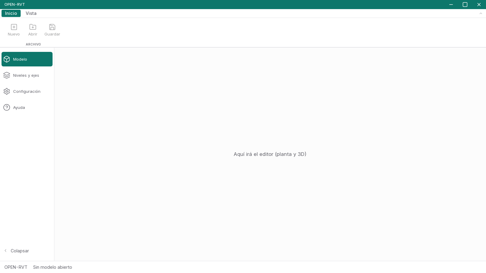

# O002 — Esqueleto de la app de OPEN-RVT

**LISTA PARA REVISIÓN**

La aplicación de escritorio ya arranca en Linux y Windows con la estructura de
PresupuestosPro: barra de título propia, ribbon, sidebar de módulos, área de trabajo vacía
y barra de estado. No hay editor ni asistente todavía.

## Copia desde PresupuestosPro

Origen: `presupuestos-pro` `master` en `fd60cde`. Detalle completo en
[`docs/origen-pp.md`](../origen-pp.md).

Resumen de `herramientas/comparar-con-pp.sh`:

```
Resumen de 86 archivos copiados:
  idénticos a PP:                 43
  adaptados:                      43
  con cambios nuevos en PP desde fd60cde: 0
```

La única ruta que cambió es la del ribbon
(`src/features/presupuesto/ribbon/` → `src/features/ribbon/`), porque la cinta es común.
Se quitaron las dependencias que ya no usa nadie (Glide Data Grid, marked, lodash, zod,
react-hook-form, pdfjs-dist, etc.).

## Qué se ve

- Barra de título con «OPEN-RVT» y los botones de minimizar, maximizar/restaurar y cerrar.
- Ribbon con dos pestañas:
  - **Inicio** → grupo Archivo: Nuevo, Abrir y Guardar, deshabilitados y con
    «Disponible pronto».
  - **Vista** → grupo Tema: Sistema, Claro y Oscuro (el mismo control de tema que PP).
- Sidebar con **Modelo**, **Niveles y ejes**, **Configuración** y **Ayuda**; Alt+1…4.
- Área de trabajo vacía: «Aquí irá el editor (planta y 3D)». Niveles y ejes queda en
  blanco.
- Configuración: Apariencia (tema y escala 100/110/120/130 %) e Idioma (español/inglés).
- Ayuda: manual de bienvenida de OPEN-RVT y ventana de atajos.
- Barra de estado: «OPEN-RVT · Sin modelo abierto».

## Captura de la app real (Linux, xvfb)



Tomada por `e2e/inicio.test.js` con la app Tauri real (tauri-driver + WebKitGTK), a
1600 × 900.

## Pruebas

### Frontend

```
$ npm run build
> tsc --noEmit && vite build
✓ built in 867ms

$ npx vitest run
Test Files  17 passed (17)
     Tests  65 passed (65)
```

Incluye las pruebas copiadas y adaptadas de `App`, `BarraTitulo`, sidebar (escala,
plegable, redimensionable, tooltip), listas/paleta/atajos, ribbon, configuración, ayuda,
ErrorBoundary, comportamiento nativo, iconos, i18n (claves, interpolación e interfaz en
inglés), formato y búsqueda difusa.

### Rust

```
$ CARGO_TARGET_DIR=$HOME/.cache/pp-target/openrvt-o002 cargo test --workspace
running 3 tests
test tests::config_por_omision_y_ida_y_vuelta_json ... ok
test tests::leer_config_inexistente_devuelve_omision ... ok
test tests::guardar_y_leer_config ... ok
test result: ok. 3 passed; 0 failed

$ CARGO_TARGET_DIR=$HOME/.cache/pp-target/openrvt-o002 cargo clippy --workspace -- -D warnings
Finished `dev` profile [unoptimized + debuginfo] target(s) in 0.43s
```

### E2E (app real)

```
$ CARGO_TARGET_DIR=$HOME/.cache/pp-target/openrvt-o002 \
  xvfb-run -a --server-args="-screen 0 2560x1600x24" node --test e2e/inicio.test.js
✔ O002: la ventana muestra título, ribbon, 4 módulos y el área de trabajo vacía
✔ O002: la pestaña Vista aplica el tema oscuro al instante
ℹ tests 2
ℹ pass 2
ℹ fail 0
```

## Instaladores

| Plataforma | Archivo | Bytes | Tamaño |
| --- | --- | ---: | ---: |
| Linux (deb) | `OPEN-RVT_0.1.0_amd64.deb` | 4 829 004 | 4.61 MiB |
| Windows (NSIS) | `OPEN-RVT_0.1.0_x64-setup.exe` | 2 686 965 | 2.56 MiB |

Comandos usados:

```
CARGO_TARGET_DIR=$HOME/.cache/pp-target/openrvt-o002 \
  npx tauri build --bundles deb

CARGO_TARGET_DIR=$HOME/.cache/pp-target/openrvt-win \
  npx tauri build --runner cargo-xwin --target x86_64-pc-windows-msvc --bundles nsis
```

Los artefactos quedan también en `instaladores/` del repositorio
(`instaladores/OPEN-RVT_0.1.0_amd64.deb` y
`instaladores/OPEN-RVT_0.1.0_x64-setup.exe`).

## Desviaciones

1. **`src/lib/bindings.ts` escrito a mano.** En PP lo genera `tauri-specta` a partir de
   todos sus comandos. OPEN-RVT solo necesita preferencias, título y registro de errores,
   así que el archivo declara esos comandos y conserva la misma forma
   `{ status, data|error }` que consume `ipc.ts`. No se copiaron los 3 080 renglones de
   tipos de presupuesto.
2. **`src-tauri` sin `tauri-specta`.** Por lo mismo, `lib.rs` registra los comandos con
   `tauri::generate_handler!` en vez de `collect_commands!`. Se conservaron los plugins,
   las capacidades, el manifiesto de Windows y `configurar_webview2` intacto.
3. **Actualizador.** PresupuestosPro no tiene código de actualización que copiar (no usa
   `tauri-plugin-updater`). Queda anotado en `Cargo.toml` y en `origen-pp.md` como
   pendiente: cuando se active harán falta el plugin, el endpoint y la llave pública.
   No se dejó ninguno de los tres.
4. **Pruebas de PP retiradas.** Las que probaban presupuesto, matriz, catálogos, reportes
   o el backend de PP no se copiaron; están listadas en `docs/origen-pp.md`. Las que
   probaban piezas del esqueleto se adaptaron y pasan.
5. **`colorTema.ts` sin Glide.** Se copió para conservar los temas de color, pero se quitó
   el tipo `Theme` y la función que pintaba la rejilla: ya no hay Glide Data Grid.
6. **Barra de estado mínima.** Se conservan el alto y el estilo de PP, pero solo muestra
   el producto y «Sin modelo abierto», porque todavía no hay totales ni problemas.
